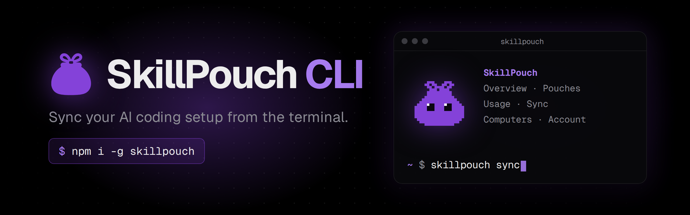
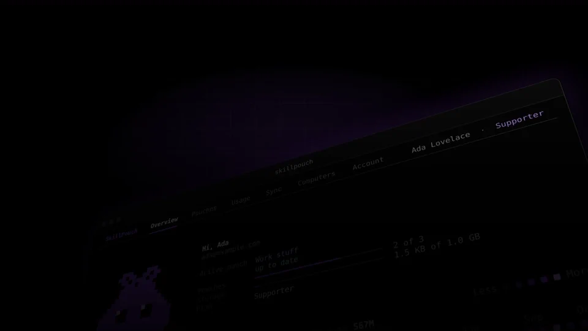
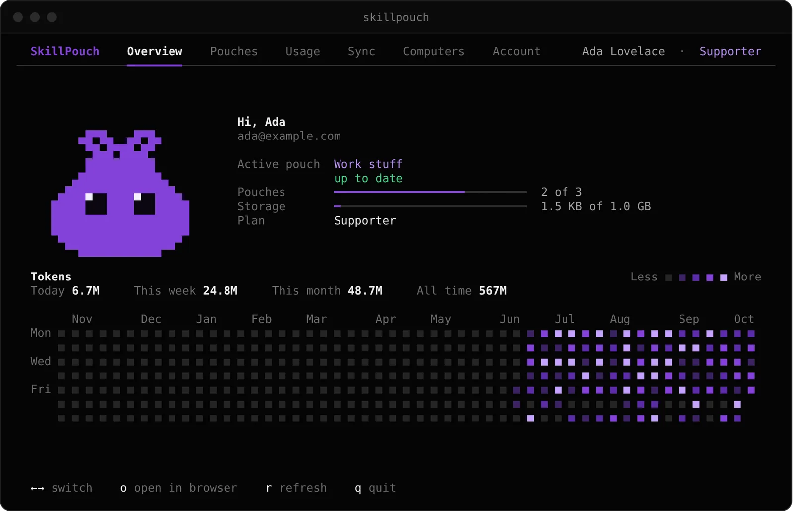
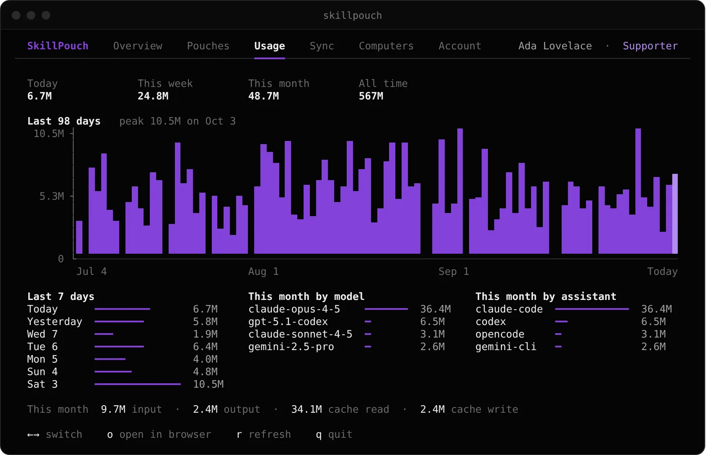

<div align="center">
  

  <p><strong>Sync the setup behind your AI coding workflow.</strong><br />A native CLI, terminal dashboard and background sync for your assistants.</p>

  <p><a href="https://skillpouch.net">Website</a> · <a href="https://app.skillpouch.net">Web app</a> · <a href="https://github.com/skillpouch/skillpouch">Server &amp; web repository</a> · <a href="https://discord.gg/u8eEJZEGhc">Discord</a></p>

  <p>
    <a href="https://github.com/skillpouch/skillpouch-cli/blob/main/LICENSE"></a>
    <a href="https://www.npmjs.com/package/skillpouch"></a>
    <a href="https://www.npmjs.com/package/skillpouch"></a>
    <a href="https://github.com/skillpouch/skillpouch-cli/actions/workflows/ci.yml"></a>
    <a href="https://discord.gg/u8eEJZEGhc"></a>
    <a href="https://skillpouch.net"></a>
  </p>
</div>

<p align="center">
  <a href=".github/assets/promo-poster.png"></a>
</p>

## Start here

Install the native CLI through npm:

```sh
npm i -g skillpouch
skillpouch
```

`skillpouch` opens the terminal dashboard. The first time, it signs this computer in through your browser and helps you choose a pouch and assistants. On a machine without a browser, use `skillpouch login <token>` with a one-time token from the [SkillPouch app](https://app.skillpouch.net).



## Commands

| Command | What it does |
| --- | --- |
| `skillpouch` | Open the TUI in a terminal; show a concise summary when non-interactive |
| `skillpouch login [<token>] [--name <name>] [--no-browser]` | Connect this computer |
| `skillpouch status [--json]` | Show account and device status |
| `skillpouch sync` | Sync now in the foreground |
| `skillpouch daemon start\|stop\|status` | Manage background sync |
| `skillpouch select [--on <name>] [--off <name>]` | Choose assistants and item kinds for this computer |
| `skillpouch conflicts` | Open the app to resolve conflicting edits |
| `skillpouch unlink [--assistant <id>]` | Stop syncing an assistant or the whole computer |
| `skillpouch logout` | Remove this computer's local credentials and keys |

Use `skillpouch --help` or `skillpouch <command> --help` for current options.

## What it brings together

The CLI detects Claude Code, Codex, OpenCode, Gemini CLI, Antigravity, Copilot CLI, Cursor, Windsurf, Qwen Code, Factory Droid and Crush. Depending on the assistant and its formats, SkillPouch can sync skills, agent definitions, instruction and command files, MCP server configurations, hooks, plugins and marketplace references. Shared skills folders are also recognized. Coverage differs by item type and assistant; the source of truth is [`sp-harness`](crates/sp-harness).

The pouch is kept as ordinary files on the computer. The CLI links supported assistant locations to those files, translates supported formats where necessary, and backs up files before replacing links. Turn off an assistant or unlink a computer and linked files are released as regular files so assistants can continue to use them.

## Background sync and privacy

`skillpouch login` configures this computer and starts the background sync service. Start or inspect it later with `skillpouch daemon start` and `skillpouch daemon status`. The daemon keeps the local pouch in sync without needing a terminal open. Auto-update checks are enabled by default for normal installations; turn them off with `SKILLPOUCH_NO_UPDATE=1` or `auto_update = false` in `~/.skillpouch/config.toml`.

Pouch content is encrypted on the client before upload; the service stores and relays ciphertext. The CLI also signs updates and uses device credentials when talking to the API. Metadata and operational details may remain visible to the service. Review the cryptographic implementation and server threat model before making a security decision for your use case.

## Usage dashboard

The TUI includes a token-usage view. The CLI reads usage counts from local Claude Code, Codex and OpenCode logs and reports counts—not prompt text—to the service during background sync. The view is informational; counts depend on what those assistants record locally.



## Configuration

| Setting | Meaning |
| --- | --- |
| `SKILLPOUCH_API_URL` | API base URL; defaults to `https://app.skillpouch.net` |
| `SKILLPOUCH_HOME` | Local SkillPouch data directory; defaults to `~/.skillpouch` |
| `SKILLPOUCH_NO_UPDATE=1` | Disable automatic update checks |
| `auto_update = false` | Disable auto-update in `~/.skillpouch/config.toml` |

For local development, `SKILLPOUCH_HOME=/tmp/sp-dev SKILLPOUCH_API_URL=http://localhost:5173 cargo run -- login` targets the local web/API dev origin. See the [server repository](https://github.com/skillpouch/skillpouch) for setup.

## Build from source

The Rust workspace is pinned by `rust-toolchain.toml` and requires a working Rust toolchain via rustup.

```sh
git clone https://github.com/skillpouch/skillpouch-cli.git
cd skillpouch-cli
cargo build --workspace
cargo run -- --help
```

Workspace checks:

```sh
cargo fmt --all
cargo clippy --workspace --all-targets --locked -- -D warnings
cargo test --workspace --locked
```

The npm package launches the native platform binary; the workspace contains the CLI, terminal UI, API client, core, crypto, sync, assistant harness and usage crates.

## Contributing

Focused issues and pull requests are welcome. Please run the relevant Rust checks, keep changes scoped, and use [Conventional Commit](AGENTS.md) messages. Documentation-only commits use `docs:` and do not trigger a release.

## License

This project is licensed under [AGPL-3.0-only](LICENSE).

<div align="center"><sub>Carry your coding context with you · <a href="https://skillpouch.net">skillpouch.net</a></sub></div>
